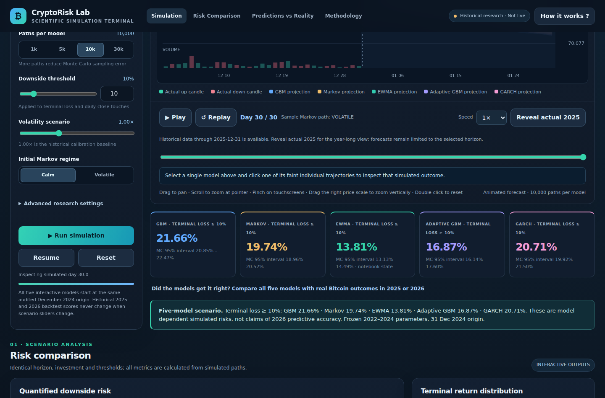
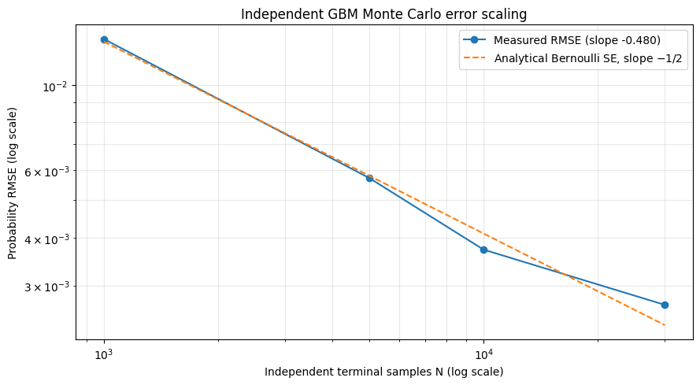

# CryptoRisk Lab

**Explore how volatility assumptions change simulated Bitcoin losses, then compare risk forecasts with what actually happened.**

**[Live simulation dashboard](https://it23372726.github.io/cryptorisk-lab/)** · **[Open research notebook in Colab](https://colab.research.google.com/github/it23372726/cryptorisk-lab/blob/main/notebook/cryptorisk-lab.ipynb)**

CryptoRisk Lab is a reproducible, self-contained scientific simulation environment. It compares five historical BTC/USDT downside-risk models, visualizes real daily-price candlesticks and modelled future paths, and makes the original 30-day GBM-versus-Markov research question empirically testable. It is **not** a live-market forecast, trade recommendation or account-connected financial service.

*Authentic Chromium screenshot captured from the working static research dashboard after a seeded five-model simulation. This is a verified interface, not a fabricated market forecast. Updated browser screenshots are archived by the [verification workflow](https://github.com/it23372726/cryptorisk-lab/actions/workflows/verify-cryptorisk-v2.yml).*

## Research question

**Primary question:** Does a two-state observed-regime Markov chain improve **30-day terminal Bitcoin loss probability forecasts** over a constant-volatility geometric Brownian motion baseline?

The original research preserves that question. EWMA is an added dynamic-volatility benchmark; Adaptive GBM, Gaussian GARCH and extra horizons are separately identified extensions.

~~~mermaid
flowchart LR
    A["Binance BTC/USDT UTC daily data"] --> B["2022–2024 calibration"]
    B --> C["Constant GBM"]
    B --> D["Two-state Markov"]
    B --> E["EWMA"]
    B --> F["Adaptive GBM / GARCH"]
    C --> G["Monte Carlo risk measures"]
    D --> G
    E --> G
    F --> G
    G --> H["Historical 2025 / 2026 validation"]
    H --> I["Brier scores, uncertainty, interpretation"]
~~~

## Quick start

**Use the browser:** Open the [live dashboard](https://it23372726.github.io/cryptorisk-lab/). Configure the investment, horizon, loss threshold and path count, then click **Run simulation**. Pause, replay, inspect individual paths and compare model risk estimates.

**Run offline:** Download/clone the repository and double-click **docs/index.html** with its neighboring JS and CSS assets intact. The website does not require a backend, data API request or developer server.

**Run the original research:** Open the badge above in Google Colab and select **Runtime → Run all**. The main notebook downloads its historical 2022–2025 spot prices and contains the original GBM, Markov, EWMA and retrospective verification. Dependencies are listed in [requirements.txt](requirements.txt).

**Advanced research reproduction:**

~~~bash
python -m pip install -r requirements.txt
python -m pip install nbclient nbformat
python scripts/verify_notebook.py
# Separate 2026 GARCH/Adaptive GBM research uses its pinned scientific environment:
python -m pip install -r research/phase3_2026/requirements-lock.txt
python research/phase3_2026/check_results.py
python research/phase4_2025/verify_extension.py
python research/phase5_horizons/verify_horizons.py
~~~

The automated scientific and browser workflows also exercise a full notebook run, offline site loading, 2025/2026 archived probability parity and a maximum-load five-model browser scenario. A successful scientific run now uploads a **fully executed copy of the main notebook** (its original cell sources preserved) together with the machine-readable verification record. Download the `notebook-2025-per-origin-forecast-data` artifact from the [verification workflow](https://github.com/it23372726/cryptorisk-lab/actions/workflows/verify-cryptorisk-v2.yml) when reviewing all saved tests, X2 error-scaling plots and X5 sensitivity intervals. The archival copy is execution evidence, not a different scientific model. See [reproducibility evidence](research/WEB_V5_HORIZON_VALIDATION.md).

## User guide

Start with **1,000 USDT**, **30 days**, **10,000 paths**, **10% loss threshold**, **1.00× volatility**, **Calm** initial regime and seed **42**. The app simulates five separate Monte Carlo ensembles and displays numerical downside probabilities, VaR95, ES95, probability bands and selected paths.

In **Predictions vs Reality**, select 2025 or 2026, a verified horizon and an origin date, then reveal actual subsequent daily closing prices. Historical scores are fixed evidence and **do not change** with hypothetical scenario controls. The original **30-day** experiment is distinguished from exploratory 7/14/60/90-day evaluations.

See [USER_GUIDE.md](USER_GUIDE.md) for every control, precise metric meanings, an example experiment and limitations.

## Models and mathematics

| Model | Return or variance assumption | Status |
|---|---|---|
| **GBM** | Fixed 2022–2024 daily log-return mean/volatility | Original baseline |
| **Two-state Markov** | Conditional calm/volatile return distributions with fitted DTMC transitions | Original primary model |
| **EWMA** | Recursively updated conditional variance; decay selected using 2024 | Stretch benchmark |
| **Adaptive GBM** | Fixed drift, most recent 30 observed daily returns determine forecast volatility | Additional retrospective model |
| **Gaussian GARCH(1,1)** | Conditional variance from prior shocks and lagged variance | Additional retrospective model |

For example, GBM simulates daily log returns $\mu+\sigma Z$; the Markov model uses $\mu_{S_d}+\sigma_{S_d}Z_d$ and advances its regime with the fitted row-stochastic transition matrix. A Monte Carlo event probability is the fraction of simulated paths with terminal loss meeting the threshold. Analytic GBM loss probabilities, VaR and ES are independent numerical verification targets.

Read [THEORY.md](THEORY.md) for equations, variable definitions, regimes, algorithm order, units, verification and a generic **Concepts applied** table.

## Verification

The main **101-cell** Colab notebook has passed a clean-kernel GitHub Actions run. It checks data integrity, independent analytical GBM probabilities and VaR/ES, Markov $P^d$ state occupancy, limiting cases, random-seed reproducibility, sensitivity and dependent historical backtesting.

The browser tests check local-file startup, controls, immutable historical evidence, exact archived Brier parity, mobile layout and a five-model stress scenario of **30,000 paths each for 90 days**.

**Scientific caveat:** Verification demonstrates that code matches its stated mathematical model. It does **not** prove those model assumptions represent real-world Bitcoin crashes accurately.

*Saved X2 notebook output: independent repeated simulations test the expected inverse-square-root relationship between path count and sampling error. See the [figure index](figures/README.md) for other published plots and their provenance.*

## Concepts applied

This project applies **input modelling and random variate generation** (historical log returns and normal shocks), **discrete-time Markov chains** (fitted two-state transitions, state occupancy $P^d$), and **Monte Carlo integration and the law of large numbers** (risk probabilities, path sampling and convergence). It checks the stochastic simulator against analytical and limiting-case results and quantifies uncertainty from repeated random seeds and overlapping historical events.

These concepts are used in the original 30-day scientific model, not merely mentioned in the UI.

## Results, limitations and future work

**Original primary event:** a terminal Bitcoin loss of **at least 10% exactly 30 days after forecast origin**, evaluated by Brier score against real subsequent closes.

| Model or benchmark | 2025 (335 origins) | 2026 (274 origins) |
|---|---:|---:|
| Historical-frequency baseline | **0.150874** | 0.176230 |
| GBM | 0.151631 | **0.175239** |
| Markov | 0.151176 | 0.178221 |
| EWMA | 0.159060 | 0.215885 |
| Adaptive GBM (2025 post-hoc) | 0.154912 | 0.218919 |
| Gaussian GARCH (2025 post-hoc) | 0.151766 | 0.176664 |

**Interpretation:** Markov was descriptively slightly better than GBM in the 2025 30-day test, but the simple calibration-only historical benchmark led for the 10% event. GBM led the corresponding 2026 test. Given overlapping forecast windows, limited rare events and dependence-aware confidence intervals, **neither period establishes broad superiority for the more complex models**. The separate 2026 study is a *fixed-protocol retrospective* evaluation, **not** a prospective blind forecast competition.

Model risk, training-period drift, normal shock assumptions, estimated state labels, market-regime changes and sparse extreme events cannot be resolved by increasing Monte Carlo path count. Historical observations and hypothetical scenarios are always presented as distinct.

Source-of-truth evidence: [Phase 1 findings](research/PHASE1_FINDINGS.md), [2026 research](research/phase3_2026/results/FINDINGS.md), [2025 additions](research/phase4_2025/results/FINDINGS.md), [multi-horizon findings](research/phase5_horizons/results/FINDINGS.md).

## Key references

Key background: [Hamilton (1989)](https://doi.org/10.2307/1912559), [Ardia, Bluteau and Rüede (2019)](https://doi.org/10.1016/j.frl.2018.08.009), [Maciel (2021)](https://doi.org/10.1002/ijfe.2043), [Poon and Granger (2003)](https://doi.org/10.1257/jel.41.2.478), [Glasserman (2003)](https://doi.org/10.1007/978-0-387-21617-1), [Bollerslev (1986)](https://doi.org/10.1016/0304-4076(86)90063-1), and [Gneiting and Raftery (2007)](https://doi.org/10.1198/016214506000001437). Full IEEE entries and their modelling relevance are in [REFERENCES.md](REFERENCES.md).

## AI assistance

ChatGPT assisted with explanations, simulation implementation, numerical verification, statistical interpretation, browser development, and documentation. Generated suggestions were evaluated against independent equations, executed source code and archived historical observations. Descriptive results were not selected to make any particular model appear superior. An early Codex implementation attempt was discarded and rebuilt with ChatGPT. Detailed private interaction records are maintained separately from this public software repository.

## Licence and data credits

Source code is released under the [MIT License](LICENSE). Third-party historical market data and referenced research remain subject to their original provider/publisher terms.

Historical BTCUSDT daily candles: [Binance Public Data](https://github.com/binance/binance-public-data). Archive hashes, derived-data provenance and third-party rights are detailed in [data/README.md](data/README.md).
